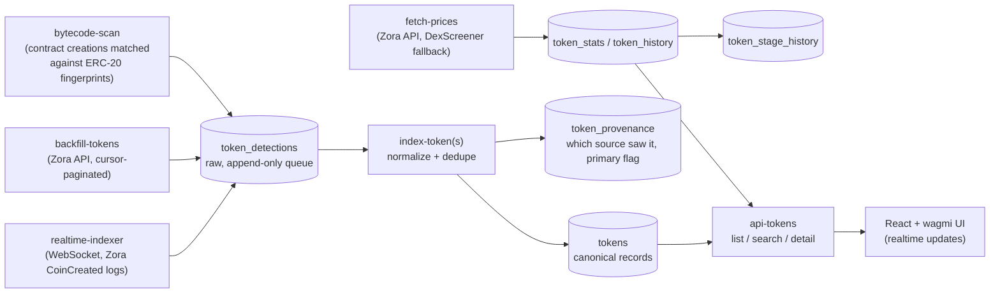

# Xeinon

**Real-time token discovery and indexing on Base.** Xeinon indexes new tokens from the block they are deployed, before they reach DEX aggregators, and then tracks each one through its lifecycle as price, liquidity and trading data arrive.

Live: [xeinon.com](https://xeinon.com)

## Architecture



Everything server-side runs as Supabase Edge Functions (Deno) against PostgreSQL. `tokens` and `token_stats` are published to Supabase Realtime, so the UI updates live.

## Design decisions

- **Raw detections are kept separate from canonical tokens.** Three sources can each see the same token: the real-time WebSocket, the historical backfill and the bytecode scanner. Each writes to `token_detections`, a queue with a partial index on unprocessed rows. Only the indexer writes to `tokens`. This keeps ingestion cheap and idempotent, and leaves deduplication to a single place.
- **Provenance is stored, not overwritten.** `token_provenance` records every source that detected a token and marks one as primary. This makes it possible to answer "how did we find this token, and how early?"
- **Lifecycle is an explicit state machine.** A `token_stage` enum moves `created → discovered → priced → liquid → traded → dead`, and every transition is logged in `token_stage_history`. The UI separates "recently detected" from "actively traded" based on stage, not guesswork.
- **Bytecode fingerprints live in data, not code.** The scanner matches contract bytecode against ERC-20 selector sets stored in `bytecode_fingerprints`, requiring 75% of selectors to match. New token standards can be added without a redeploy. A hardcoded selector check serves as the fallback.
- **Enrichment degrades gracefully.** Prices come from the Zora API with DexScreener as fallback, using exponential backoff with jitter on `429`. Liquidity records whether it came from a DEX or an estimate (`liquidity_source`).

## Data model

| Table | Role |
|---|---|
| `token_detections` | Raw detection queue, one row per sighting per source |
| `tokens` | Canonical token: platform, creator, creation tx/block/log index, stage, source |
| `token_provenance` | Every source that saw the token; the primary source is flagged |
| `token_stats` / `token_history` | Current market data, plus a time series for charts |
| `token_stage_history` | Audit trail of lifecycle transitions |
| `creator_profiles`, `users`, `transactions` | Creator metadata, wallet-linked users, trade log |

## Known limitations

- Platform coverage is Zora-first. Clanker, Flaunch and Mint Club are modelled in the `token_platform` enum but not fully wired up.
- The `users` and `transactions` tables currently allow anonymous inserts under RLS. Writes should move behind wallet-signature-verified edge functions.
- There are no automated tests yet. The next step is integration tests for the detection → index path, plus replaying recorded logs.

## Stack

TypeScript · React · Vite · wagmi · Supabase (PostgreSQL, Edge Functions, Realtime) · Base / EVM

## Run locally

```sh
git clone https://github.com/macjayz/xeinon.git
cd xeinon
npm install
npm run dev
```

The edge functions need `SUPABASE_URL` and `SUPABASE_SERVICE_ROLE_KEY`, plus an RPC WebSocket URL for `realtime-indexer` and, optionally, `ZORA_API_KEY`. Set these as Supabase function secrets.
